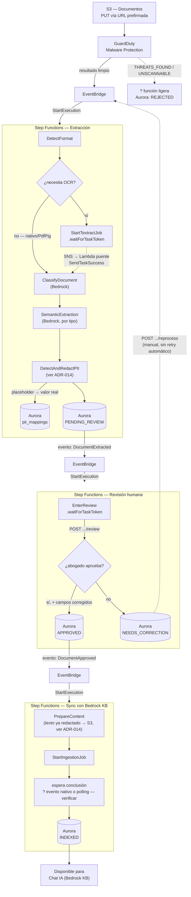
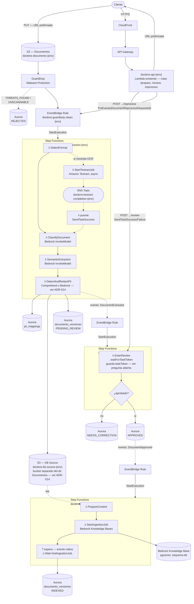

# ADR-011 — Disparo del Procesamiento de Documentos

**Estado:** Aceptada (2026-09-07) — Supera a [ADR-006](006-sync-vs-async-processing.md) y sustituye el mecanismo de compuerta descrito en la sección "Enfoque elegido" de [ADR-004](004-malware-scanning.md).

---

## Decisión

El procesamiento de un documento se dispara automáticamente cuando **Amazon GuardDuty Malware Protection completa el escaneo**, sin que el cliente llame a ningún endpoint de tipo `/process`.

```
GuardDuty (resultado del escaneo) → regla de EventBridge (filtra solo resultado limpio) → SQS + DLQ → Lambda Processor
```

La Lambda Processor ya no necesita leer el tag `GuardDutyMalwareScanStatus` por sondeo con reintentos — la regla de EventBridge solo reenvía a SQS cuando el resultado del escaneo es el adecuado. El endpoint `POST /documents/process` desaparece del flujo del cliente.

---

## Contexto

[ADR-006](006-sync-vs-async-processing.md) decidió el procesamiento asíncrono vía SQS, pero mantenía un endpoint `POST /documents/process` llamado explícitamente por el cliente después del `PUT` a S3, y dejaba que la Lambda worker sondeara el tag de GuardDuty con reintentos vía el *visibility timeout* de SQS cuando el escaneo aún no había terminado. Esa misma ADR ya dejaba anotada, como "Opción 3 — bajo discusión", la posibilidad de un disparo completamente dirigido por eventos.

Al redefinir la arquitectura V1, se formalizó ese disparo por eventos, pero usando **GuardDuty + EventBridge** como origen del evento (no una notificación `S3:ObjectCreated`), ya que GuardDuty Malware Protection para S3 publica el resultado del escaneo como evento en EventBridge de forma nativa.

## Opciones consideradas

### Opción 1 — Endpoint `/process` + sondeo de tag en la Lambda worker (ADR-006 original)

**Fortalezas:** señal explícita del cliente de "empezar a procesar"; simple de trazar en un solo flujo lógico.

**Debilidades:** el cliente debe orquestar una llamada adicional después del `PUT`; el caso de "tag ausente" (escaneo aún en curso) es manejado con reintentos de SQS, añadiendo latencia y complejidad al Lambda worker; existe una ventana en la que un `PENDING` puede quedar huérfano si el cliente nunca llama a `/process`.

### Opción 2 — Notificación `S3:ObjectCreated` → SQS directamente

Disparar el procesamiento en cuanto el `PUT` a S3 se completa, sin pasar por GuardDuty como filtro explícito en el evento de disparo.

**Debilidades:** el escaneo de GuardDuty apenas ha comenzado cuando el evento de S3 se dispara — el caso "tag ausente" pasa a ser el caso común en lugar de la excepción, empujando de vuelta el problema de reintentos hacia la Lambda worker.

### Opción 3 — GuardDuty → EventBridge → SQS (elegida)

**Fortalezas:**

- El evento que dispara el procesamiento es exactamente "el escaneo terminó con resultado limpio" — no hay ventana de "tag ausente" que gestionar por reintentos: la regla de EventBridge simplemente no reenvía nada hasta que el resultado exista.
- Elimina el endpoint `/process` y la Lambda de intake asociada — menos código, menos superficie de API.
- Elimina la ventana de `PENDING` huérfano — no existe un paso intermedio donde la subida se complete pero el procesamiento nunca se dispare.
- El filtrado (solo continuar con resultado limpio) ocurre en la propia regla de EventBridge, no dentro de la lógica de negocio de la Lambda Processor.

**Debilidades:**

- Un componente más en la infraestructura (regla de EventBridge) a definir en Terraform.
- Depurar el flujo requiere revisar la regla de EventBridge además de la cola SQS y la Lambda — la trazabilidad end-to-end pasa por un componente administrado adicional.

---

## Comparación

| Dimensión | Endpoint `/process` + sondeo (ADR-006) | S3:ObjectCreated directo | GuardDuty → EventBridge (elegida) |
|---|---|---|---|
| Llamada explícita del cliente | Sí | No | No |
| Caso "escaneo no terminado" | Común, gestionado con reintentos SQS | Muy común | No ocurre — el evento solo existe cuando el escaneo terminó |
| Riesgo de `PENDING` huérfano | Sí | No | No |
| Lambda de intake / endpoint `/process` | Sí | No | No |
| Complejidad de infraestructura | Media | Media | Media (regla de EventBridge) |

---

## Enfoque elegido

> **Revisión 2026-09-21:** el disparo por GuardDuty + EventBridge se mantiene sin cambios (sección original más abajo). Lo que cambia es *qué* consume el evento: en vez de una única Lambda Processor, la extracción, la revisión humana y la sincronización con el Knowledge Base pasan a ser **tres AWS Step Functions state machines encadenadas por eventos propios en EventBridge**, no una cadena de Lambdas coordinadas a mano vía columnas de estado en Aurora. El motivo: las tres etapas comparten la misma forma ("inicia un trabajo → espera a que termine → continúa") — Textract asíncrono, aprobación de un abogado, `StartIngestionJob` de Bedrock — y Step Functions modela ese patrón de forma nativa (`waitForTaskToken`) en vez de reimplementarlo tres veces con mecanismos distintos.
>
> **Nota sobre SQS + DLQ:** el diagrama de abajo dispara la state machine de Extracción directo desde el target `StartExecution` de la regla de EventBridge, sin la cola SQS que la sección original de esta ADR describe. Los targets de EventBridge admiten su propia `RetryPolicy` + `DeadLetterConfig` nativos — cubren el mismo motivo por el que se eligió SQS+DLQ ("desacoplar el evento del procesamiento") sin una cola intermedia. **Esto no está verificado contra la cuenta real todavía** — si al implementar no alcanza, la cola SQS+DLQ original sigue siendo la opción de respaldo.
>
> Detalle completo de la comparación Lambda-encadenada vs. Step Functions en la sesión de arquitectura del 2026-09-21 (no versionado aún como documento aparte).



1. Frontend: `POST /documents/prepare` → `{ documentId, versionNumber, uploadUrl }`
2. Frontend: `PUT {uploadUrl}` → `200 OK` (directo a S3)
3. S3: versionado, cifrado, objeto original persistido
4. GuardDuty escanea el objeto
5. Regla de EventBridge — filtra únicamente el resultado "limpio", dispara la state machine de **Extracción**
6. Extracción detecta formato, extrae texto (ver ADR-003), clasifica y analiza semánticamente (Bedrock) → Aurora `PENDING_REVIEW` → emite `DocumentExtracted`
7. Ese evento dispara la state machine de **Revisión humana** — bloqueante: el documento no avanza hasta que un usuario interno apruebe (o corrija) los campos extraídos
8. Aprobado → Aurora `APPROVED` → emite `DocumentApproved`, que dispara la state machine de **Sync con Bedrock KB** (`StartIngestionJob` → Aurora `INDEXED`)
9. Frontend: sondea `GET /documents/{documentId}/versions/{versionNumber}` hasta que el estado sea `INDEXED` (o `NEEDS_CORRECTION`/`REJECTED`)

Un resultado `THREATS_FOUND` o `UNSCANNABLE` de GuardDuty no genera evento hacia la state machine de Extracción — la regla de EventBridge lo filtra. Quién marca el registro como `REJECTED` sigue siendo una pregunta abierta (ver más abajo, sin cambios respecto a la versión original de esta ADR).

## Recursos AWS por componente

El diagrama anterior muestra estados lógicos. Este muestra qué recurso de AWS implementa cada uno — el nivel al que se escribe el Terraform de `infra/terraform/modules/processing`.



- **`λ` = función Lambda.** Cada una necesita su propio rol IAM con permisos mínimos (mismo patrón que `modules/processing/iam.tf` ya usa para las tres Lambdas actuales) — no se listan aquí para no duplicar lo que ya vive en Terraform.
- **Dos buckets S3, no uno.** `doclens-documents-{env}` guarda los originales (con PII, tal cual los sube el cliente); `doclens-kb-source-{env}` solo recibe texto ya redactado (ver [ADR-014](014-pii-redaction.md)). Son buckets separados a propósito — el rol IAM que Bedrock Knowledge Bases asume para `StartIngestionJob` solo tiene permiso de lectura sobre `doclens-kb-source-{env}`, nunca sobre `doclens-documents-{env}`. Esa separación es lo que hace la garantía "el KB nunca ve PII" estructural (imposible por IAM) en vez de solo convencional (depende de que el *data source* apunte al prefijo correcto).
- **`doclens-api-{env}` es una sola Lambda con varias rutas** (`/prepare`, `/review`, `/reprocess`) — no una Lambda nueva por cada acción del cliente. `CloudFront` enruta tanto los assets estáticos (a `S3 — Frontend`, no mostrado aquí) como las llamadas de API hacia este mismo API Gateway/Lambda — un solo dominio para el cliente.
- **Pregunta de diseño sin resolver:** ¿cada paso (`DetectFormat`, `ClassifyDocument`, `SemanticExtraction`, `DetectAndRedactPII`...) es una función Lambda separada, o varias comparten una sola función "worker" con ruteo por acción (mismo patrón que las tres Lambdas actuales comparten un único ZIP con handlers distintos, ver `variables.tf`)? Afecta cuántos recursos `aws_lambda_function` aparecen en Terraform, no el diseño lógico del state machine.
- Los tres `EventBridge Rule` del diagrama son reglas distintas, cada una con su propio target `StartExecution` hacia la state machine correspondiente — no una sola regla compartida.

## Consecuencias

- **[ADR-006](006-sync-vs-async-processing.md):** superada en su totalidad — el endpoint `/process`, la Lambda de intake y el modelo de sondeo de tag ya no aplican.
- **[ADR-004](004-malware-scanning.md):** el mecanismo de compuerta (tag-polling en la Lambda worker) queda superado por esta ADR; la decisión de usar GuardDuty Malware Protection como escáner no cambia.
- **API Reference:** se elimina `POST /documents/process` de la superficie pública de la API.
- **Terraform:** se añade la regla de EventBridge y su política de destino hacia SQS; se elimina la Lambda de intake dedicada a `/process`.
- **IAM:** la Lambda Processor ya no necesita `s3:GetObjectTagging` para sondeo — el filtrado ocurre antes, en EventBridge.
- **Observabilidad:** las trazas de X-Ray deben propagarse desde el evento de EventBridge hacia el mensaje de SQS y la invocación de la Lambda Processor para mantener un trace correlacionado.

## Preguntas abiertas

- ¿Qué componente actualiza el estado a `REJECTED` cuando GuardDuty reporta `THREATS_FOUND`/`UNSCANNABLE` — una regla de EventBridge adicional apuntando a una función ligera, o un manejador dentro de la misma state machine de Extracción con una ruta de entrada distinta?
- ¿Cuál es la política de reintentos y el tiempo de vida de mensajes en la DLQ antes de requerir intervención manual?
- **(2026-09-21)** ¿Dónde vive el `taskToken` de la espera de revisión humana — una columna nueva en `documento_versiones`, o una tabla `document_reviews` separada que también sirva de historial de auditoría (quién aprobó qué, cuándo)?
- **(2026-09-21)** ¿Qué `tipoUsuario` puede llamar al endpoint nuevo `POST /documents/{id}/versions/{n}/review` — cualquier usuario interno, o un rol de revisor específico que el modelo de permisos actual todavía no distingue?
- **(2026-09-21)** ¿`StartIngestionJob` de Bedrock Knowledge Bases publica su finalización como evento en EventBridge (mismo patrón que Textract), o la state machine de Sync KB necesita un `Wait` + `GetIngestionJob` en bucle (polling real, no callback)? Verificar contra la API actual antes de implementar.
