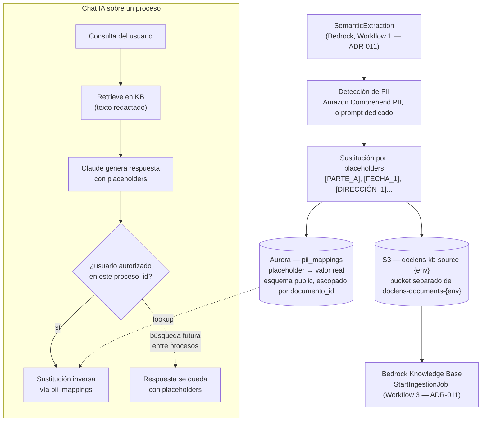

# ADR-014 — Redacción de PII en el Pipeline de Ingesta al Knowledge Base

**Estado:** Propuesta (2026-09-23)

---

## Decisión

Antes de que cualquier texto extraído de un documento llegue al Bedrock Knowledge Base (KB), el pipeline de Extracción ([ADR-011](011-document-processing-trigger.md)) detecta información de identificación personal (PII) y la sustituye por placeholders estables (`[PARTE_A]`, `[FECHA_1]`, `[DIRECCIÓN_1]`...). El mapeo placeholder → valor real se guarda en una tabla nueva de Aurora, en el esquema `public` — nunca en el esquema `kb` (ver [ADR-008](008-data-storage-strategy.md)). El texto redactado se escribe en `doclens-kb-source-{env}`, un **bucket S3 separado** de `doclens-documents-{env}` (donde viven los originales) — el rol IAM de Bedrock Knowledge Bases solo tiene acceso al primero. El Knowledge Base **nunca almacena PII en texto plano** — es una propiedad estructural del pipeline, garantizada por IAM, no una convención de código que alguien pueda olvidar aplicar.

---

## Contexto

El V1 exige cumplimiento RGPD y confidencialidad entre distintos clientes de un mismo despacho (ver el documento de redefinición del proyecto). El aislamiento actual ([ADR-001](001-rag-strategy.md)/[ADR-008](008-data-storage-strategy.md)) filtra cada `Retrieve` por `{ empresa_id, proceso_id }` — esto basta mientras toda búsqueda esté siempre acotada a un único proceso.

Durante la sesión de arquitectura del 2026-09-23 surgió la posibilidad de, más adelante, clasificar `procesos` por área del derecho (`area_derecho` — laboral, divorcio, civil...) para habilitar búsquedas de conocimiento común entre procesos similares (p. ej. "cómo redactamos cláusulas de custodia antes"). Ese tipo de búsqueda, si alguna vez se construye, tendría que dejar de filtrar por `proceso_id` — y ahí aparece el riesgo: dos procesos de la misma área pero de clientes distintos del mismo despacho podrían filtrar datos personales de un cliente hacia una búsqueda relacionada con otro.

Se consideró usar hashing de campos PII conocidos para mitigar esto, y se descartó: nombres y números de documento son valores de baja entropía, reversibles por fuerza bruta o diccionario sin necesitar romper el hash en sí; y el problema real no es solo el nombre — el contexto alrededor (dirección, fechas, relaciones familiares, empleador) identifica a una persona igual, incluso sin su nombre literal presente.

Esta ADR no decide construir la búsqueda entre procesos — decide la precondición técnica que la haría segura *si* algún día se construye, y que además reduce la superficie de exposición de PII dentro del propio Knowledge Base incluso en el alcance actual (un proceso a la vez).

---

## Opciones consideradas

### Opción 1 — No redactar; mantener el aislamiento solo vía `proceso_id` (statu quo)

**Fortalezas:** cero trabajo nuevo; ya es suficiente para el alcance actual del V1 (chat acotado a un proceso).

**Debilidades:** bloquea cualquier búsqueda entre procesos sin abrir riesgo de fuga de datos personales entre clientes del despacho; no reduce la superficie de exposición de PII dentro del propio KB — un proceso comprometido, o un bug en el filtro de `proceso_id`, expone datos personales en texto plano.

### Opción 2 — Hashing de campos PII conocidos

**Fortalezas:** simple de implementar, determinístico, reconoce la misma entidad entre documentos sin trabajo extra.

**Debilidades:** valores de baja entropía (nombres, DNI/NIF) son reversibles por fuerza bruta/diccionario sin salt — un hash de "María García" no esconde que es "María García"; no toca el contexto circundante que también identifica a la persona; no cumple el estándar de anonimización real de RGPD — sigue siendo pseudonimización reversible, con las mismas obligaciones legales que el dato en claro.

### Opción 3 — Detección y redacción de PII vía NER, con mapeo reversible fuera del KB (elegida)

**Fortalezas:** el KB nunca contiene PII en texto plano, sea cual sea el alcance de una búsqueda futura; el mapeo reversible permite que el chat de un proceso específico siga mostrando datos reales a un usuario autorizado sobre ese proceso — no se pierde utilidad en el caso de uso principal del V1; habilita una futura búsqueda entre procesos sin abrir una superficie de fuga nueva.

**Debilidades:** la detección de PII por NER nunca es 100% — nombres inusuales, PII dentro de tablas/anexos, identificadores indirectos (p. ej. "empleado de la Empresa Y") pueden escapar sin ser detectados; la tabla de mapeo se vuelve, ella misma, un activo sensible que concentra PII y requiere cifrado/control de acceso equivalente al de cualquier dato personal; agrega un paso nuevo — y su latencia — al pipeline de Extracción.

---

## Comparación

| Dimensión | Statu quo | Hashing | NER + mapeo reversible (elegida) |
|---|---|---|---|
| PII en el KB | Sí, texto plano | Ofuscada, pero reversible por fuerza bruta | No, nunca |
| Habilita búsqueda entre procesos sin nuevo riesgo | No | No | Sí |
| Se acerca al estándar de anonimización RGPD | No aplica | No — pseudonimización débil | Más cerca — mapeo reversible sigue siendo dato personal, pero aislado y controlado |
| Trabajo de implementación | Ninguno | Bajo | Medio-alto |
| Riesgo residual | Alto (contexto sin redactar) | Alto (nombre/DNI recuperables) | Bajo-medio (recall de NER no es 100%) |

---

## Enfoque elegido

1. Tras `SemanticExtraction` (Workflow 1, [ADR-011](011-document-processing-trigger.md)), el texto procesado pasa por un paso nuevo de detección de PII.
2. Cada entidad detectada (nombre completo, DNI/NIF, dirección, teléfono, email, fecha de nacimiento, IBAN...) se reemplaza por un placeholder estable — `[PARTE_A]` se refiere siempre a la misma persona dentro de ese documento.
3. El mapeo se inserta en una tabla nueva, `pii_mappings (id, documento_id, placeholder, valor_real, tipo_entidad, creado_en)`, en el esquema `public` — nunca en el esquema `kb`.
4. Solo el texto redactado se escribe en `doclens-kb-source-{env}` — un bucket S3 **separado** de `doclens-documents-{env}` (donde viven los originales), no solo un prefijo distinto dentro del mismo bucket. El rol IAM que Bedrock Knowledge Bases asume para `StartIngestionJob` solo tiene permiso de lectura sobre `doclens-kb-source-{env}`; nunca tiene permiso alguno sobre `doclens-documents-{env}`. Así la garantía "el KB nunca ve PII" es estructural — imposible por IAM, no depende de que el *data source* de Bedrock esté correctamente configurado para apuntar al prefijo correcto.
5. En el chat sobre un proceso específico, tras generar la respuesta, la Lambda hace la sustitución inversa usando `pii_mappings`, condicionada a que el usuario tenga permiso sobre ese `proceso_id` (misma tabla `permisos` de siempre — ver [ADR-008](008-data-storage-strategy.md)).
6. Una eventual búsqueda entre procesos omite ese último paso — la respuesta se queda con los placeholders, porque el KB nunca tuvo el dato real para empezar.

---

## Consecuencias

- **[ADR-001](001-rag-strategy.md):** el filtro `{ empresa_id, proceso_id }` sigue siendo obligatorio para el chat por proceso; esta ADR no lo reemplaza, lo complementa — reduce el daño de una eventual fuga, no sustituye el control de acceso.
- **[ADR-011](011-document-processing-trigger.md):** la state machine de Extracción gana un estado nuevo entre `SemanticExtraction` y la escritura a `doclens-kb-source-{env}`. La de Sync KB no cambia — sigue ingiriendo lo que encuentre en ese bucket, que ahora siempre está redactado. `doclens-kb-source-{env}` es un bucket nuevo en el Terraform de `infra/terraform/modules/processing` (o `modules/documents` en `DocLens.Infra`, a decidir según dónde viva `doclens-documents-{env}` hoy), con su propio rol/política IAM para Bedrock Knowledge Bases.
- **[ADR-008](008-data-storage-strategy.md):** nueva tabla `pii_mappings` en el esquema `public` — se agrega al boceto de esquema.
- **API:** el endpoint de chat/consulta de un proceso necesita el paso de sustitución inversa antes de devolver la respuesta — afecta el contrato que documente `api-reference.md`.
- **Costo:** si se usa Amazon Comprehend PII detection, cobra por unidad de texto procesado — sumar a la estimación de costo del proyecto.
- **No decide construir la búsqueda entre procesos.** Esta ADR es la precondición técnica que la haría segura, no la decisión de producto de construirla — esa sigue siendo una conversación aparte, sin ADR propia todavía.

---

## Preguntas abiertas

- ¿Amazon Comprehend PII detection (servicio dedicado) o un prompt de Bedrock pidiendo a Claude que detecte y etiquete entidades? Comprehend es más predecible y barato por volumen; un prompt de Bedrock podría tener mejor recall en texto jurídico en español, pero sin SLA de precisión conocido — hay que evaluar ambos contra documentos reales antes de decidir.
- ¿El placeholder es estable solo dentro de un documento, o a lo largo de todo un proceso (para que `[PARTE_A]` sea la misma persona en todos los documentos de un mismo caso)? Esto último es más útil pero exige resolución de entidades entre documentos, no solo dentro de uno.
- ¿Qué tipos de entidad se redactan como mínimo? Nombre completo, DNI/NIF, dirección, teléfono, email, fecha de nacimiento, IBAN — ¿se incluyen también nombres de empresas/empleadores, que en un caso laboral también pueden ser identificantes?
- ¿`pii_mappings` necesita cifrado a nivel de columna además del cifrado en reposo de Aurora, dado que es, por diseño, una tabla que concentra PII?
- Si `NEEDS_CORRECTION` ([ADR-011](011-document-processing-trigger.md)) dispara una re-extracción, ¿se regenera el mapeo de PII desde cero, o se reutiliza el existente cuando la corrección es menor?
