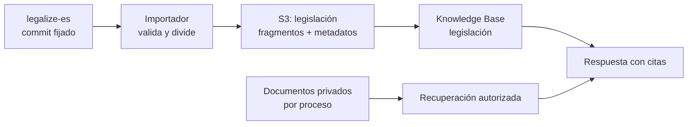

# PoC — legislación española en la búsqueda de DocLens

**Estado:** propuesta para implementar y validar. Ninguna de las pruebas descritas aquí se ha ejecutado todavía.

## Objetivo y alcance

Comprobar que DocLens puede ingerir un conjunto pequeño de normas españolas, recuperar el artículo pertinente y mostrar una cita verificable al BOE junto a los documentos de un proceso. La PoC usa una instantánea identificada por el commit de [`legalize-es`](https://github.com/legalize-dev/legalize-es); no intenta cubrir toda la legislación española ni responder automáticamente qué redacción era aplicable en una fecha pasada.

Empezar con tres normas del repositorio publicado: `BOE-A-1978-31229` (Constitución), `BOE-A-2015-10565` (Ley 39/2015) y `BOE-A-2015-10566` (Ley 40/2015). Confirmar que los tres archivos existen en la instantánea elegida antes de exportar. El BOE describe su colección consolidada como una selección de normas relevantes, principalmente leyes estatales y autonómicas; sus textos consolidados tienen carácter informativo ([alcance y límites del BOE](https://www.boe.es/datosabiertos/faq/consolidada.php)).

## Encaje con DocLens

El [ADR-001](adrs/001-rag-strategy.md) prevé Bedrock Knowledge Bases para fragmentación, indexación y recuperación; [ADR-008](adrs/008-data-storage-strategy.md) prevé Aurora con `pgvector`. El flujo actual de documentos privados usa `empresa_id` y `proceso_id` como filtros obligatorios ([arquitectura](architecture.md#modelo-de-multi-tenancy)). La legislación es contenido compartido y debe tener un índice o fuente de datos independiente. El backend consulta cada ámbito por separado: primero autoriza el proceso, luego recupera sus documentos con los filtros habituales y, si la consulta lo requiere, recupera legislación. Cada resultado conserva su procedencia. No se asigna una ley a un tenant ficticio ni se elimina el filtro de los documentos privados.

El código actual de `DocLens.Backend` acepta `text/markdown` al preparar una subida, pero el servicio de extracción existente llama a Textract y aún no implementa lectura directa de Markdown ni recuperación en Knowledge Bases. Esta PoC requiere un importador de legislación y un servicio de consulta; no pasa por `POST /documents/prepare` ni por el flujo de GuardDuty para archivos subidos por clientes.

## Flujo propuesto

1. Fijar el commit de entrada de `legalize-es` y registrar ese SHA en un manifiesto de importación. Leer solo los tres Markdown elegidos. Para esta primera prueba usar el corpus publicado, sin ejecutar la reconstrucción completa del pipeline: la ruta genérica de descubrimiento masivo de España aún necesita corrección.
2. Separar el frontmatter YAML del cuerpo. Validar `identifier`, `country: es`, `title`, `source`, `publication_date` y `last_updated`; rechazar un archivo sin esos campos. Tratar `status` y `last_updated` como metadatos de origen, no como prueba de vigencia jurídica en una fecha consultada.
3. Dividir el cuerpo por encabezados de artículo o sección y conservar el encabezado en cada fragmento. Si una división no identifica el artículo de forma inequívoca, marcar el fragmento como sección y no inventar un número. Asignar un ID estable: `BOE-ID + identificador-del-bloque + hash-del-contenido`.
4. Escribir los fragmentos como `.md` en un prefijo S3 exclusivo de legislación, con archivos `.metadata.json` adyacentes para la fuente de Knowledge Bases. La [documentación de AWS](https://docs.aws.amazon.com/bedrock/latest/userguide/knowledge-base-ds.html) admite Markdown UTF-8; sus [metadatos por documento](https://docs.aws.amazon.com/bedrock/latest/userguide/s3-data-source-connector.html) permiten filtrar y devolver la procedencia. Conservar al menos `boe_id`, `titulo`, `articulo_o_seccion`, `source_url`, `publication_date`, `last_updated` y `corpus_commit`.
5. Indexar esa fuente y ejecutar consultas de recuperación. Mostrar en la respuesta el título, artículo o sección, ID BOE, fecha de la instantánea y enlace oficial. Identificar el contenido como «texto consolidado de carácter meramente informativo» y atribuir los datos al BOE, conforme a sus [condiciones de reutilización](https://www.boe.es/informacion/aviso_legal/index.php).

## Primeros tests

| Nivel | Prueba | Resultado esperado |
|---|---|---|
| Importación local | Repetir la importación del mismo commit | Mismos IDs y hashes; ningún fragmento duplicado |
| Importación local | Frontmatter incompleto o artículo ambiguo | Error explícito o fragmento marcado como sección; ninguna cita inventada |
| Recuperación | Pregunta sobre un artículo conocido de cada una de las tres normas | Fragmento correcto entre los primeros resultados, con ID BOE, sección y URL oficial |
| Aislamiento | Consultar como dos tenants con procesos distintos | Los documentos privados se filtran por `empresa_id` y `proceso_id`; la legislación compartida es la misma |
| Respuesta | Pregunta que requiere un documento del caso y una norma | Dos citas diferenciadas: documento privado y BOE |
| Límites | Pregunta por una norma ausente o por su vigencia en una fecha histórica | Declarar falta de evidencia; no inferir vigencia desde el commit o desde `status` |

Preparar un pequeño conjunto de preguntas y artículos esperados revisado por una persona del equipo jurídico. Guardar para cada caso la pregunta, el `boe_id`, el artículo esperado y el enlace oficial. La PoC pasa si todas las pruebas de importación y aislamiento son correctas, las tres preguntas de recuperación encuentran su artículo esperado y ninguna respuesta sin evidencia fabrica una cita. Registrar latencia y coste de ingestión/consulta antes de ampliar el corpus.

## Riesgos y siguiente paso

El [listado de defectos de España](https://github.com/legalize-dev/legalize-pipeline/issues/106) documenta referencias omitidas y problemas de representación en el corpus publicado; parte del código ya cambió, pero los archivos afectados aún necesitan reemisión. Por eso esta PoC evalúa **búsqueda y procedencia**, no exactitud jurídica histórica. Una ampliación deberá comparar una muestra de artículos con el BOE, definir cómo actualizar o retirar fragmentos cuando cambie el commit de entrada y decidir si se indexa solo la versión actual o también versiones históricas. Esta última opción necesita un modelo explícito de fechas y pruebas específicas antes de exponer consultas «vigente el día X».
